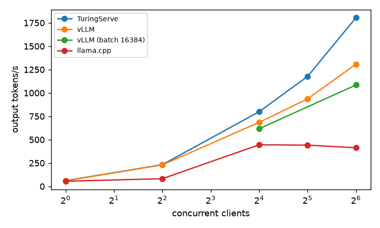
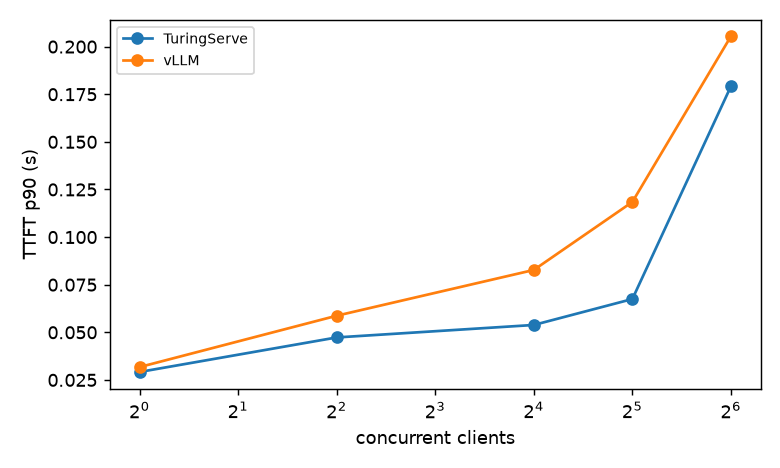
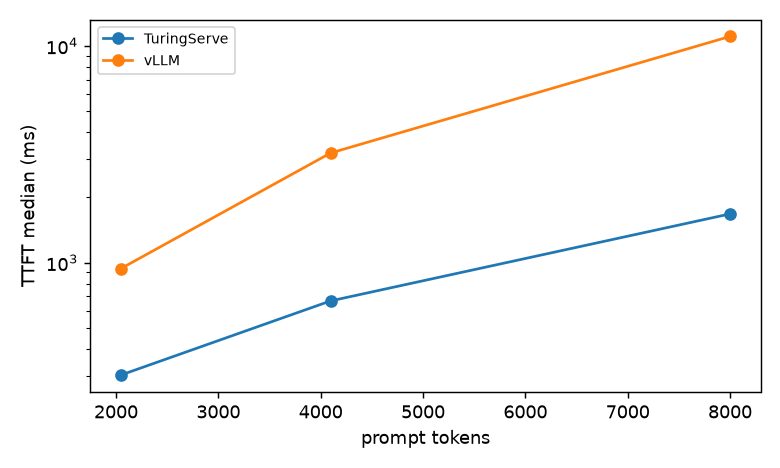
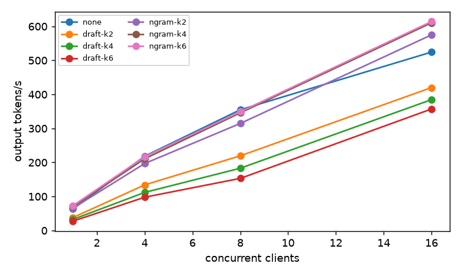

# TuringServe benchmark report

_Generated by `benchmarks/make_report.py` from the JSON files in `benchmarks/results/`. No number below is typed by hand. Method, run sizes and known limits: [docs/benchmark_methodology.md](../docs/benchmark_methodology.md)._

## Environment

| engine | GPU / driver | commit | date | result files |
|---|---|---|---|---|
| Hugging Face | Tesla T4, 580.178.04 | 349b3f3 | 2026-11-02 | 1 |
| TuringServe | Tesla T4, 580.178.04 | edd9b7d | 2026-11-02 | 10 |
| TuringServe | Tesla T4, 580.178.04 | 349b3f3 | 2026-11-02 | 1 |
| TuringServe | Tesla T4, 580.178.04 | 1e7c73a | 2026-11-03 | 1 |
| vLLM | Tesla T4, 580.178.04 | 1e7c73a | 2026-11-03 | 4 |

All numbers are from one Kaggle Tesla T4 (sm_75, 15 GiB), Qwen2.5-1.5B-Instruct fp16 unless stated. TuringServe runs use torch 2.6.0+cu124 / Triton 3.2.0; the vLLM runs use vLLM 0.33.0 / torch 2.14.0+cu130 with its TRITON_ATTN backend. Commit hashes in the older files predate a history rewrite (same content; see the methodology document).

## ShareGPT throughput and latency vs concurrency

Output tokens per second (higher is better); `ignore_eos` so every request generates its full reference length. Sample size (prompts x repetitions) differs per engine and level; see the second table.

| concurrency | TuringServe | vLLM | TuringServe / vLLM |
|---|---|---|---|
| 1 | 61.2 | 59.1 | 1.04x |
| 4 | 232.2 | 229.7 | 1.01x |
| 16 | 799.5 | 685.3 | 1.17x |
| 32 | 1176.3 | 936.3 | 1.26x |
| 64 | 1805.2 | 1308.0 | 1.38x |

| concurrency | engine | TTFT p50 (ms) | TTFT p90 (ms) | TPOT p50 (ms) | TPOT p90 (ms) | goodput | errors | prompts x reps |
|---|---|---|---|---|---|---|---|---|
| 1 | TuringServe | 27 | 29 | 16.3 | 16.4 | 100% | 0 | 500x3 |
| 1 | vLLM | 27 | 32 | 17.0 | 17.4 | 100% | 0 | 60x2 |
| 4 | TuringServe | 44 | 47 | 17.1 | 17.2 | 100% | 0 | 500x3 |
| 4 | vLLM | 52 | 59 | 16.8 | 17.7 | 100% | 0 | 150x2 |
| 16 | TuringServe | 48 | 54 | 19.4 | 19.6 | 100% | 0 | 500x3 |
| 16 | vLLM | 71 | 83 | 22.1 | 23.2 | 100% | 0 | 400x2 |
| 32 | TuringServe | 56 | 67 | 25.6 | 25.9 | 100% | 0 | 500x3 |
| 32 | vLLM | 103 | 118 | 31.2 | 33.0 | 100% | 0 | 400x2 |
| 64 | TuringServe | 64 | 179 | 31.5 | 31.9 | 100% | 0 | 500x3 |
| 64 | vLLM | 141 | 205 | 43.1 | 44.6 | 100% | 0 | 400x2 |

## Cold prefill (prefix caching off): time to first token by prompt length

One request at a time, 5 prompts per length, 3 repetitions. TuringServe ran with `--no-prefix-caching`, vLLM with `--no-enable-prefix-caching`; the spread inside each length is under a few percent, so every request was cold.

| prompt tokens | TuringServe | vLLM | TuringServe speed-up vs vLLM |
|---|---|---|---|
| 2048 | 303 ms (6,767 tok/s) | 939 ms (2,182 tok/s) | 3.1x |
| 4096 | 665 ms (6,158 tok/s) | 3,204 ms (1,278 tok/s) | 4.8x |
| 8000 | 1,678 ms (4,769 tok/s) | 11,065 ms (723 tok/s) | 6.6x |

For reference, vLLM issue #60821 reports **10.2 s** for an 8,000-token prompt: vLLM-latest default backend, T4, Qwen2.5-1.5B (issue #60821); 1.1 s with FlashInfer, which is disabled on SM75 by default. Re-measure right before publishing (PR #55380 may change this).

## Speculative decoding (ShareGPT, output tok/s and change vs no speculation)

| method | c=1 | c=4 | c=8 | c=16 |
|---|---|---|---|---|
| none | 63.3 | 218.4 | 354.9 | 524.5 |
| draft-k2 | 38.1 (-40%) | 134.1 (-39%) | 219.6 (-38%) | 420.1 (-20%) |
| draft-k4 | 32.6 (-48%) | 112.0 (-49%) | 183.1 (-48%) | 384.7 (-27%) |
| draft-k6 | 27.5 (-57%) | 97.9 (-55%) | 153.2 (-57%) | 357.2 (-32%) |
| ngram-k2 | 65.7 (+4%) | 196.9 (-10%) | 314.7 (-11%) | 575.1 (+10%) |
| ngram-k4 | 70.3 (+11%) | 210.9 (-3%) | 345.9 (-3%) | 610.6 (+16%) |
| ngram-k6 | 73.1 (+15%) | 216.7 (-1%) | 349.3 (-2%) | 614.4 (+17%) |

Run size: 40x2 (prompts x repetitions).

## Autopilot (Poisson load 0.5 -> 4 -> 0.5 req/s, 120 s each)

| configuration | out tok/s | TTFT p50 / p90 (ms) | TPOT p50 (ms) | goodput | errors | requests per rep |
|---|---|---|---|---|---|---|
| autopilot-full | 444.2 | 56 / 72 | 25.8 | 100% | 0 | 587 |
| autopilot-off-best-fixed | 450.5 | 53 / 65 | 25.4 | 100% | 0 | 587 |
| autopilot-off-default | 443.6 | 50 / 66 | 25.5 | 100% | 0 | 587 |

Autopilot made 51 decisions in the `full` run: R3 spec_skip x6, R4 spec_k x17, R4 spec_on x27, R5 spec_k x1.

## Hugging Face naive baseline (smoke run only)

One request at a time behind a global lock; a full sweep was impractical (see the methodology document). This is a 10-prompt, single-repetition indicator, not a sweep.

| concurrency | out tok/s | TTFT p50 (ms) | TPOT p50 (ms) | errors | prompts x reps |
|---|---|---|---|---|---|
| 1 | 27.8 | 84 | 35.5 | 0 | 10x1 |

## Quality: WikiText-2 perplexity

| engine | dtype | weights | perplexity | vs first row |
|---|---|---|---|---|
| Hugging Face | float16 | - | 9.2122 | +0.000% |
| TuringServe | float16 | - | 9.2123 | +0.000% |
| TuringServe | float16 | INT8 W8A16 | 9.2270 | +0.160% |

## Quality: GSM8K (5-shot, chat template, 1319 questions)

| precision | flexible-extract | strict-match |
|---|---|---|
| fp16 | 0.6050 +/- 0.0135 | 0.3465 +/- 0.0131 |
| int8 | 0.6012 +/- 0.0135 | 0.3541 +/- 0.0132 |

## Limitations

Every published performance number comes from one Kaggle T4 on one stack; relative comparisons are the intended use. Run sizes differ between experiments (see the methodology document), the Hugging Face baseline is a smoke run, speculation and Autopilot results are small samples, and prefix caching affects repeated prompts in repetitions 2 and later. Laptop (GTX 1650) numbers are for correctness only.
